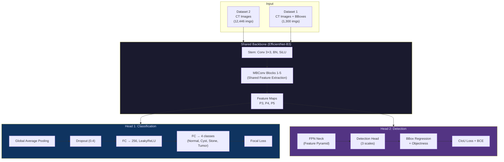
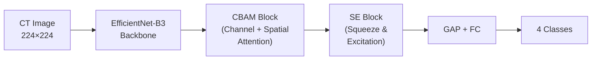
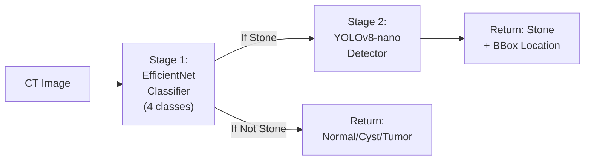
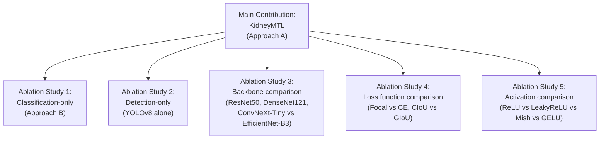

# 🧠 Phase 2: Formulating a Novel Strategy

## The Big Picture: What Gets a Paper Accepted?

Conference reviewers look for **3 things**:
1. **Novelty** — Are you doing something no one has done before?
2. **Technical Depth** — Is your method well-designed and justified?
3. **Strong Results** — Do you beat the state-of-the-art?

The CDR-VGG19 paper's fatal weakness: it does **one simple task** (binary classification) with a **2014-era backbone** (VGG19). We're going to exploit every gap we found in Phase 1.

---

## 📐 Three Proposed Approaches

---

### 🏆 Approach A: Multi-Task Learning (MTL) — *RECOMMENDED*

**Paper Title Idea:** *"KidneyMTL: A Unified Multi-Task Framework for Simultaneous Kidney Disease Classification and Stone Localization from CT Scans"*

This is the approach you asked about, and it's the strongest for publication.

#### What is Multi-Task Learning? (Teacher Explanation 🎓)

> Imagine you're learning to be a doctor. If you only learn to say "this patient has a kidney stone" (classification), you're useful but limited. But if you simultaneously learn to **diagnose the disease type** AND **point to exactly where the stone is** on the CT scan — you become far more valuable.
>
> That's MTL: **one brain (shared backbone) learns multiple related tasks at once**. The magic is that learning Task A (classification) actually helps Task B (detection) and vice versa, because they share features. This is called **positive transfer**.

#### Architecture Diagram



#### Why Each Component? (Teacher Explanations 🎓)

**1. Why EfficientNet-B3 instead of VGG19?**

| Aspect | VGG19 (Their Choice) | EfficientNet-B3 (Our Choice) |
|--------|---------------------|------------------------------|
| Year | 2014 | 2019 |
| Parameters | 143M | **12M** (12× smaller!) |
| Top-1 Accuracy (ImageNet) | 74.5% | **81.6%** |
| FLOPs | 19.6B | **1.8B** (11× faster!) |
| Key Innovation | Just stacked convolutions | Compound scaling (depth + width + resolution) |

> 🎓 **Why this matters for us:** Medical datasets are small. VGG19's 143M parameters will **overfit** on our 12,446 images. EfficientNet-B3's 12M parameters are the sweet spot — powerful enough to learn complex features, small enough not to memorize the training data.

**2. Why Leaky ReLU in the classification head instead of standard ReLU?**

```
Standard ReLU:  f(x) = max(0, x)
Leaky ReLU:     f(x) = max(0.01x, x)
```

> 🎓 **The "Dying ReLU" Problem:** In standard ReLU, if a neuron's output goes negative, the gradient becomes **exactly zero**. That neuron effectively "dies" — it never learns again. With medical images, where subtle grayscale differences matter, losing neurons is dangerous.
>
> **Leaky ReLU** gives a small slope (0.01) for negative values, so neurons can always recover. For our classification head where we need to distinguish subtle differences between Cyst and Tumor, this matters.
>
> **In the shared backbone:** EfficientNet uses **SiLU** (also called Swish: `x * sigmoid(x)`), which is even better — it's smooth, non-monotonic, and consistently outperforms both ReLU and Leaky ReLU in modern architectures.

**3. Why Focal Loss for classification instead of Cross-Entropy?**

> 🎓 **The class imbalance problem:** Your Dataset 2 has:
> - Normal: **5,077** images (40.8%)
> - Cyst: **3,709** images (29.8%)
> - Tumor: **2,283** images (18.3%)
> - Stone: **1,377** images (11.1%)
>
> With standard Cross-Entropy, the model will learn to always predict "Normal" because that's the easiest way to get ~40% accuracy for free. It won't focus on the hard cases.
>
> **Focal Loss** adds a modulating factor: `FL = -α(1-p)^γ * log(p)`
> - When the model is **confident and correct** (p → 1): the `(1-p)^γ` term → 0, so the loss is tiny. The model ignores easy examples.
> - When the model is **wrong** (p → 0): the term → 1, so the loss is high. The model focuses on hard, misclassified examples.
> - `γ = 2` (recommended): Focus factor. Higher = more focus on hard examples.
> - `α` per class: We'll set higher α for Stone (minority class).

**4. Why CIoU Loss for detection instead of simple L1/L2?**

> 🎓 Standard L1 loss just measures pixel distance between predicted and true bounding boxes. But a box can have the same L1 error while being in a completely wrong position!
>
> **CIoU (Complete Intersection over Union)** considers 3 things:
> 1. **Overlap** (IoU) — how much the boxes intersect
> 2. **Distance** — center-point distance between boxes
> 3. **Aspect ratio** — are the box shapes similar?
>
> For kidney stones, which can be small and vary in shape, CIoU gives much better gradients for the model to learn from.

#### The MTL Loss Function

```
Total Loss = λ_cls × Focal_Loss(classification) + λ_det × (CIoU_Loss + BCE_objectness)
```

- `λ_cls = 1.0`, `λ_det = 0.5` (start here, we'll tune)
- When a batch contains **only classification images** (Dataset 2): `λ_det = 0` (detection loss is masked)
- When a batch contains **detection images** (Dataset 1): both losses are active

> [!IMPORTANT]
> **This alternating training is a key novelty.** We don't need every image to have both labels. The shared backbone learns from *both* tasks even when only one is available for a given image.

#### Academic Novelty Claim
1. ✅ **First MTL framework** for simultaneous kidney disease classification + stone localization
2. ✅ **Cross-dataset learning** — backbone learns shared representations from two different data sources
3. ✅ **4-class classification** vs. their binary
4. ✅ **Spatial localization** with bounding boxes (clinically actionable)
5. ✅ **Modern backbone** (EfficientNet-B3) vs. VGG19

---

### 🥈 Approach B: Attention-Enhanced Classification Only

**Paper Title Idea:** *"AttentiveKidney: CBAM-Enhanced EfficientNet with Focal Loss for Robust Kidney Disease Classification"*

A simpler approach — focus purely on classification but with attention mechanisms.



#### What is CBAM? (Teacher Explanation 🎓)

> 🎓 Think of it this way: when a radiologist looks at a CT scan, they don't look at every pixel equally. They **pay attention** to certain regions (spatial attention) and certain image features like edges or textures (channel attention). CBAM teaches the model to do the same:
>
> - **Channel Attention:** "Which feature maps are important?" (e.g., edge features might matter more than color features for stones)
> - **Spatial Attention:** "Which regions of the image matter?" (e.g., the kidney region, not the background)

**Pros:** Simpler to implement, fewer moving parts, easier to debug  
**Cons:** Doesn't use Dataset 1 at all, less novelty, no localization

---

### 🥉 Approach C: Two-Stage Cascade

**Paper Title Idea:** *"CascadeKidney: A Two-Stage Deep Learning Pipeline for Kidney Disease Triage and Stone Localization"*



**Pros:** Each model is optimized for its task, easy to explain  
**Cons:** Two separate models (no shared learning), slower inference, less academic novelty

---

## 🔬 Comparison Matrix

| Criteria | Approach A (MTL) | Approach B (Attention) | Approach C (Cascade) |
|----------|:---:|:---:|:---:|
| **Academic Novelty** | ⭐⭐⭐⭐⭐ | ⭐⭐⭐ | ⭐⭐ |
| **Uses Both Datasets** | ✅ | ❌ | ✅ (separately) |
| **Localization** | ✅ (unified) | ❌ | ✅ (separate) |
| **Implementation Complexity** | High | Low | Medium |
| **Inference Speed** | Fast (1 model) | Fastest | Slowest (2 models) |
| **Publication Potential** | 🔥 Very High | Medium | Medium |
| **Your Learning Value** | 🧠 Maximum | Moderate | Moderate |
| **Deployment (Web API)** | Clean (1 endpoint) | Simplest | 2 endpoints |

---

## 🎯 My Recommendation: Approach A (MTL) + Approach B as Ablation

Here's the strategy for maximum conference impact:



> [!TIP]
> **Why ablation studies matter:** Reviewers love them. They prove you didn't just get lucky — you systematically tested each design choice. The paper's CDR-VGG19 has **zero** ablation studies — they just showed "our model is best" without explaining *why*.

---

## 📋 What We'll Build (Step-by-Step Roadmap)

If you approve Approach A, here's our coding plan:

| Step | Module | What You'll Learn | Where |
|------|--------|-------------------|-------|
| 1 | `src/config.py` | Update hyperparams for MTL | Local |
| 2 | `src/datasets/` | DataLoaders for both datasets | Local → Colab |
| 3 | `src/models/backbone.py` | EfficientNet-B3 feature extractor | Local → Colab |
| 4 | `src/models/cls_head.py` | Classification head with Focal Loss | Local → Colab |
| 5 | `src/models/det_head.py` | Detection head (lightweight FPN + head) | Local → Colab |
| 6 | `src/models/mtl_model.py` | Unified MTL model combining both heads | Local → Colab |
| 7 | `src/training/trainer.py` | Training loop with alternating batches | Colab |
| 8 | `src/training/losses.py` | Focal Loss + CIoU Loss implementations | Local |
| 9 | `src/evaluation/` | mAP, confusion matrix, Grad-CAM | Colab |
| 10 | `src/export/` | ONNX/TorchScript export for deployment | Local |
| 11 | Ablation Notebooks | All comparison experiments | Colab |
| 12 | `results/` | Tables, plots, visualizations for paper | Local |

---

## ⚠️ Risk Assessment

| Risk | Mitigation |
|------|-----------|
| MTL training instability (one task dominates) | Dynamic loss weighting (uncertainty-based) |
| Dataset 1 is small (1,300 images) | Transfer learning from ImageNet + augmentation |
| Detection mAP might be low on small dataset | Start with a simpler head; demonstrate the *framework* is novel |
| Class imbalance in Dataset 2 | Focal Loss + class-weighted sampling |
| Training takes too long on Colab | EfficientNet-B3 is lightweight; mixed precision (FP16) training |

---

> [!IMPORTANT]
> **Your decision needed:** Which approach do you want to build?
> - **Approach A (MTL)** — Maximum novelty, most learning, best for publication
> - **Approach B (Attention-only)** — Simpler, faster to implement
> - **Approach C (Cascade)** — Two separate models
>
> I recommend **Approach A**. It directly addresses the paper's biggest gaps and gives us the strongest novelty claim.

**Once you approve, we start Phase 3: Step-by-step coding, beginning with the data loaders.** 🚀
